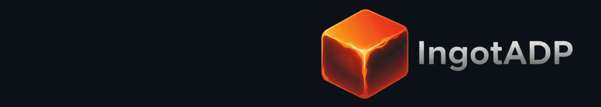

# Ingot - Secure

> Pre-merge governance, vulnerability scanning, and Policy-as-Code engine for IngotADP.   

# Licence

The `ingot-secure` repository is open source and provided under the [MIT License](https://github.com/ingotadp/ingot-secure/blob/main/LICENSE).   

